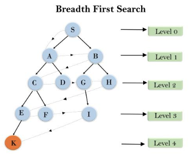

## Crawling approach

The crawler uses breadth-first search (BFS): it processes the start page, then
all directly linked pages, before processing deeper links.

Pages waiting to be processed are stored in a FIFO queue (First In, First
Out). New pages are added to the end of the queue, and the next page is taken
from the front. This ensures that direct links are processed before deeper
pages.





A configuration object:
- `start_url` - the starting page; its crawl depth is 0.
- `allowed_domain` - the domain boundary for recursive crawling, derived from `start_url`. Hostnames under the same base domain are allowed; for example, `example.com`, `www.example.com`, and `cdn.example.com` are treated as belonging to the same domain.
- `recursive` bool - whether recursive crawling is enabled. If no `-r` argument is provided, process only the starting page.
- `max_recurs_depth` - maximum crawl depth when recursion is enabled. The default value is 5 and it can be set by `-r -l [N]`.
- `path` - a string. it has a default value `./data/` but also it can be specified.

`CrawlState` is runtime state for one execution:
- `visited_urls` - a set of normalized page URLs already queued or processed. It is shared by the breadth-first crawl.
- `successful_page_requests` - count of successful page requests.
- `failed_page_requests` - count of failed page requests.
- `downloaded_images` - count of successfully saved images.
- `failed_downloads` - count of images that could not be saved.

```python
    from dataclasses import dataclass, field

    @dataclass
    class CrawlState:
        visited_urls: set[str] = field(default_factory=set)
        successful_page_requests: int = 0
        failed_page_requests: int = 0
        downloaded_images: int = 0
        failed_downloads: int = 0
```

I want to have such funcions.

- `main` - entry point. Only coordinates the application: parse command-line arguments, build the configuration, handle only top-level application errors.

    - `parse_args` - parsing and and validate command-line arguments, error handling of the wrong type of the arguments.
        - It should validate that a URL is provided and call `normalize_url` for the starting URL. Normalization prevents equivalent URLs from being crawled repeatedly: https://example.com/page and https://example.com/page#section. The fragment #section does not identify a different HTTP document, so it should usually be removed.
        - `-l` is an integer,
        - recursion depth is non-negative,
        - `-p` specifies the output directory, using `./data/` when omitted,
        - `-l` is used with `-r`; without `-r`, only the starting page is processed and no links are followed.
    
    The function should **return** parsed configuration `config`.

    -  Create the runtime state object after parsing the arguments. `CrawlState` is a class, and `CrawlState()` creates an object.

    - `normalize_url` - return a canonical absolute URL for comparisons and requests. Remove the fragment, normalize a leading `www.` hostname to the base hostname, remove the `/de` language prefix, and ensure the URL has a supported HTTP scheme. Use it for the starting URL and for links after resolving them with `urljoin`.

    - `crawl(current_url, current_depth, config, state, parent_dir)` - Process one page from the breadth-first queue.

    The queue initially contains `(config.start_url, 0, config.path)`. Each queue item contains the URL, its crawl depth, and the nearest qualifying parent directory.

    1. If recursion is disabled, process only the initial URL. Otherwise, repeatedly remove the first item from the queue and check the depth limit using `max_recurs_depth`. The initial item has `current_depth` 0. Do not enqueue links beyond the maximum depth.
    
       `config.start_url` has already been normalized by `parse_args`. Every queued link is resolved and normalized by `parse_html`, so `crawl` does not repeat normalization.
    
    2. Check its domain. Continue only if the normalized `current_url` belongs to the `allowed_domain` domain. Stop if it is outside the allowed domain.

    3. Stop if already visited. Add a normalized URL to `visited_urls` when it is enqueued, before it can be discovered through a deeper link. This prevents circular links and ensures that a direct link is preferred over a deeper duplicate.

    4. `fetch_page()` - perform the HTTP request, set a timeout and handle HTTP/network errors. Check the status code of the response to the URL: if it is not a 2xx code, display an error with the status code; if it is a 2xx response with a body, send the body to the next function for parsing. Updates the request counters in `CrawlState` object.

    5. `parse_html()` - Extract image sources and page links. It receives HTML content and the current page URL. The current page URL is needed to resolve relative links.
    
    It should extract: image `src` values and anchor `href` values.

    This function uses Beautiful Soup to parse the HTML page. It searches for all `` elements and links to the `src` of these images. It should return structured results, such as a collection of image sources and page links. It should not itself perform network requests, downloads, or domain filtering.

    Every returned image source is passed to `download_image()` function. This function does not create directories.

    For each anchor link, first resolve the possibly relative `href` with `urljoin(current_url, href)`, then call `normalize_url` on the resulting absolute URL. Return these normalized page links to `crawl`; `crawl` performs the domain check. This keeps URL conversion separate from crawl policy.

    6. Create the sub-directory while processing the queued page.

        After `fetch_page()` succeeds and `parse_html()` returns its results, the page-processing function checks whether the page contains at least one supported image source. The starting page (depth 0) uses `config.path` directly. For a page at depth greater than 0 with supported images, it creates a sub-directory inside the current `parent_dir`. This happens before calling `download_image()` and before enqueuing the page links.

        If the page has no supported image sources, `crawl()` does not create a sub-directory. Its child pages continue to use the current `parent_dir`. The starting page is an exception: `config.path` is the root directory and its images are saved directly there.

        ```python
        current_dir = parent_dir

        if current_depth > 0 and has_supported_images(image_sources):
            current_dir = create_subdirectory(parent_dir, current_depth)
        ```

    7. `download_image()`.

        - For each image source returned by `parse_html`, this function takes the current page URL and image source as arguments, then resolves the source with `urljoin`.
        - Validate the image URL and extension. We are interested in the images with such extenstions - `.jpg/jpeg`, `.png`, `.gif`, `.bmp`.
        - Request the binary content. Handle HTTP and network errors, and count unsuccessful image requests as failed downloads.
        - Save the image in the output directory created and provided by `crawl()`. If `crawl()` cannot create a directory because the `a`-to-`z` limit was reached, it does not call `download_image()` for that page.
        - Choose a safe output filename. Two different URLs may have the same basename, such as `logo.png`; avoid overwriting an existing file by appending a timestamp to each file to create a unique name.
        - Write the response bytes. (Save as a file) 
        - Image file-save success and failures are counted in `downloaded_images` and `failed_downloads` respectively.

    8. Continue crawling. If recursive crawling is enabled, iterate over the normalized page links returned by `parse_html`. For each link that has not been visited, add it to `visited_urls` and append `(link, current_depth + 1, current_dir)` to the end of the queue. Processing the queue in (First In, First Out) order ensures that all direct links are processed before deeper links.

    ```python
    queue = deque([(config.start_url, 0, config.path)])
    state.visited_urls.add(config.start_url)

    while queue:
        current_url, current_depth, parent_dir = queue.popleft()
        image_sources, links = process_page(
            current_url, current_depth, config, state, parent_dir
        )

        for link in links:
            if (
                current_depth < config.max_recurs_depth
                and link not in state.visited_urls
            ):
                state.visited_urls.add(link)
                queue.append((link, current_depth + 1, current_dir))
    ```

## Folder structure

I want to organise downloaded images into a hierarchical folder structure that reflects the website's page hierarchy.

Folders represent qualifying pages and their nearest qualifying ancestors:

root/
├── page-1a/
│   ├── image-1.jpg
│   └── page-2a/
│       └── image-2.png
└── page-1b/

`page-Nx` uses the crawl depth (`N`) and the qualifying-child order (`x`) under the same parent. For example, `page-1a` and `page-1b` are sibling pages; `page-2a` is a qualifying child of `page-1a`.

Each parent supports letters `a` through `z`. If the limit is reached, print a message, continue crawling, and do not save that page's images.

`config.path` is the root directory; the starting page saves directly there.

Create subdirectories while processing pages.

Pages without supported images do not create directories. Their children use the nearest qualifying ancestor:

root/
└── page-with-images/
    └── child-with-images/

Direct links from the same page are siblings:

start
├── about-us  -> page-1a
└── events    -> page-1b
