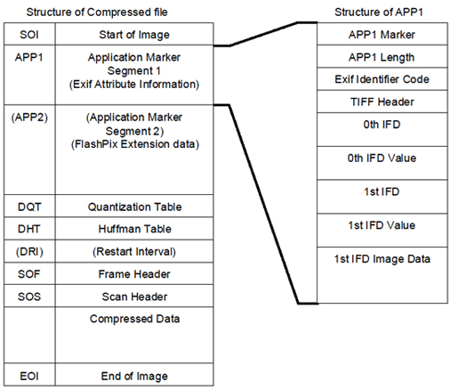

# Scorpion

Displays basic image attributes, creation date, and EXIF metadata.

CLI program invoked as 

```bash
./scorpion FILE1 [FILE2 ...].
```

Support `.jpg/.jpeg`, `.png`, `.gif`, and `.bmp`.


Install dependency

```bash
python3 -m pip install -r requirements.txt
```

Help

```bash
python3 spider.py --help
```

---

## Cleanup

```bash
python3 -m pip show Pillow
python3 -m pip uninstall Pillow
``

stat - display file or file system status

SYNOPSIS
       stat [OPTION]... FILE...

## Structure of JPEG



EXIF is commonly stored in an APP1 segment in JPEG files.

## hex dump

In a hex dump, each byte (8 bits) is represented as a two-digit hexadecimal number.

The Unix program `hexdump` - display file contents in hexadecimal.

### Locate the APP1 segment

```bash
hexdump -C img_test/peacock.jpg | grep -i -m 1 "ff e1"
```

In JPEG files, `ff e1` is the marker identifying an APP1 segment. For
example:

```text
00000000  ff d8 ff e1 db 78 45 78  69 66 00 00 49 49 2a 00
```

The left column is the byte offset. Here, `ff e1` starts at offset `0x02`.
The two bytes immediately after the marker (`db 78`) are the APP1 segment
length.

The APP1 payload starts after the marker and length:

```text
ff e1 [length: db 78] [APP1 payload: 45 78 69 66 00 00 ...]
                  └── "Exif\0\0"
```

The bytes `45 78 69 66 00 00` are the ASCII signature `Exif\0\0`, confirming
that this APP1 segment contains EXIF metadata.
