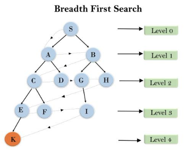

Help

```bash
python3 spider.py --help
```

Install dependency

```bash
python3 -m pip install -r requirements.txt
```

## Cleanup

```bash
python3 -m pip show beautifulsoup4
python3 -m pip uninstall beautifulsoup4
``

Added:

- recursive `page-depth-letter` directories;
    - `a`–`z` sibling limit;
- Beautiful Soup HTML parsing;
- crawl/download statistics;

Run it with:

```bash
# no options
python3 spider.py https://example.com
# with options
python3 spider.py -r -l 5 -p ./data/ https://example.com
```

The spider accepts HTTP and HTTPS URLs. It downloads only these image formats:

- `.jpg`
- `.jpeg`
- `.png`
- `.gif`
- `.bmp`

---

## Crawling approach

The crawler uses breadth-first search (BFS): it processes the start page, then
all directly linked pages, before processing deeper links.

Pages waiting to be processed are stored in a FIFO queue (First In, First
Out). New pages are added to the end of the queue, and the next page is taken
from the front. This ensures that direct links are processed before deeper
pages.




---

**USER_AGENT header**

A custom user agent is useful for transparency, server-side logging, debugging, and complying with crawler policies. It does not bypass access controls or guarantee that a request will be accepted.

If no `User-Agent` header is specified, Python’s `urllib` usually sends its own default identity, such as: `Python-urllib/3.x`

---

The help output is generated dynamically by Python’s standard-library `argparse` module.

---


